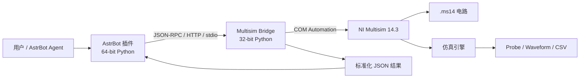
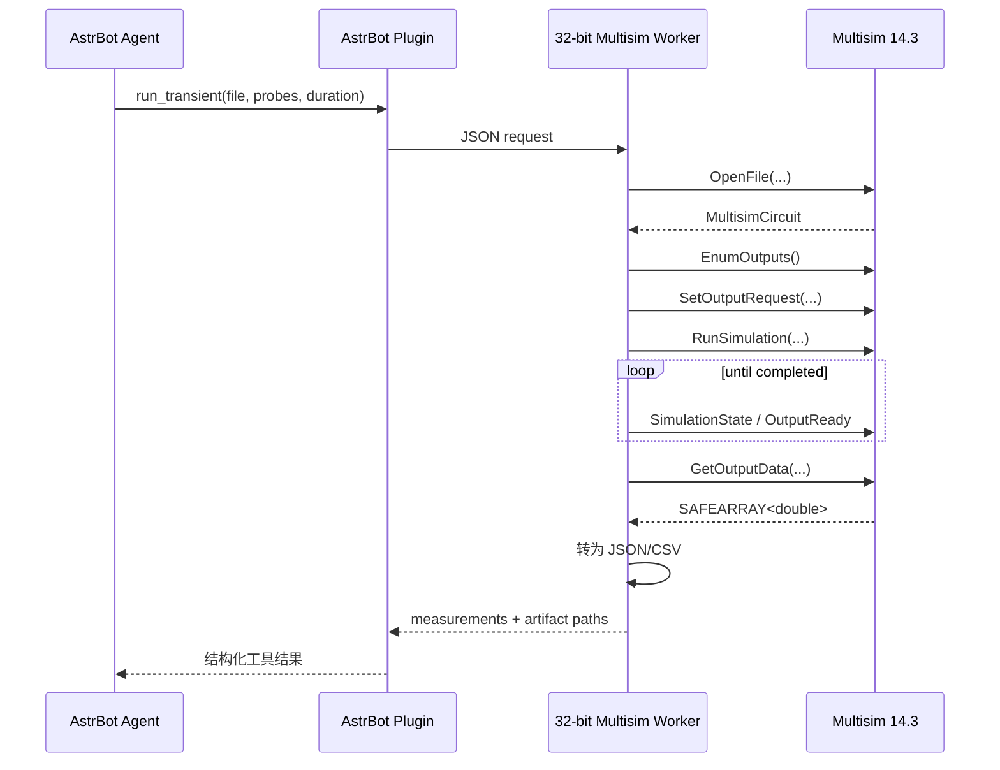
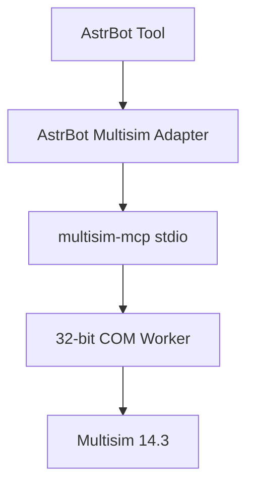
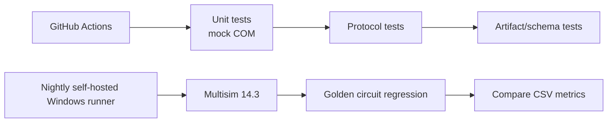

# NI Multisim 14.3 Agent 自动化与 AstrBot 插件开发可行性研究报告

## 执行摘要

目标是让 AstrBot 中的 Agent 能够以“工具调用”的方式控制本机 NI Multisim 14.3，完成打开/生成电路、修改元件参数、启动 DC/AC/Transient 仿真、读取探针波形和测量值、批量参数扫描、保存工程以及导出 CSV/报告。NI 官方文档确认 Multisim 提供 COM Automation API，其核心对象是 `MultisimApp` 与 `MultisimCircuit`，可由任何支持 COM 的语言调用；API 可打开设计文件、运行仿真、设置输入输出、读取探针结果、执行 SPICE/Nutmeg 命令，并提供一定程度的电路编辑功能。citeturn433088search1turn433088search7turn849961search2

对 Multisim 14.3 而言，**最值得优先采用的技术路线不是 GUI 自动化，而是“32 位 COM Worker + 独立 Agent/MCP/AstrBot 前端”**。现有 `yxy050208/multisim-mcp` 项目已经验证了这一架构：Multisim COM 在独立 32 位 Python worker 中运行，而 MCP 前端可以使用 32 位或 64 位 Python；项目作者还给出了 Multisim 14.3 原生验收记录，包括 OP/DC/AC/Transient、工程保存重开、波形和报告导出。其 1.3.0 已于 2026 年 10 月 26 日发布到 PyPI，并采用 MIT 许可证。citeturn291066view0turn380351search2

因此，对 AstrBot 最合理的工程策略是：**不要在 AstrBot 主进程中直接绑定 Multisim COM**。AstrBot 官方插件体系是 Python，支持 AI Tool、外部服务集成以及插件 Web API；可以让插件通过本地 stdio/HTTP/JSON-RPC 调用一个单独的 32 位 Python Multisim bridge。这样既解决 32/64 位 COM 兼容问题，也能隔离 Multisim 崩溃、COM apartment、权限和 GUI 生命周期。AstrBot 官方文档明确建议插件通过 `requirements.txt` 管理依赖，并允许注册 AI 工具和 Web API，因此此架构与 AstrBot 原生模型非常契合。citeturn682923search0turn682923search1turn682923search3

综合可行性、维护成本和稳定性，本报告建议采用三层结构：



其中第一阶段可直接包装现有 `multisim-mcp`；第二阶段再根据 AstrBot 需求缩减为 10–20 个稳定工具，而不是把项目中上百个 MCP Tool 全部暴露给模型。现有 `multisim-mcp` 被第三方检测到约有 123 个 Tool，完整暴露会明显扩大 LLM 工具选择空间和安全面，因此更适合在 AstrBot 层做领域化封装。citeturn380351search4turn969812view2

预估工作量方面，如果已有合法的 Multisim 14.3 环境和一台 Windows 测试机，基于现有 `multisim-mcp` 做 AstrBot Adapter 的可用原型约 **5–8 人日**；构建自己的 COM bridge 并达到生产可用程度约 **12–20 人日**；如果要求 Agent 从零任意布线、放置元件并达到较高稳定性，则会增加 GUI/模板/拓扑生成工作，整体可能达到 **25–40 人日**。这一估算是基于本报告所述工程拆分的工程推算，而非 NI 官方数据。

## 官方能力、接口边界与关键事实

### Multisim 14.3 与 Automation API

NI 当前下载页显示 Multisim 14.3 Education 包含 14.3.0 和 14.3.1，支持 Windows 10/11 64 位以及 Windows Server 2016/2019；安装程序本身可以在 64 位 Windows 上运行，但公开项目和历史 COM 实践表明 Multisim Automation COM 仍需要特别注意 32 位客户端兼容。citeturn849961search7turn291066view0

官方 Automation API 的核心设计相当清楚。NI 表示 Automation Interface 暴露两个主要对象：`MultisimApp` 和 `MultisimCircuit`。客户程序可以打开电路、运行仿真、获取仿真结果、选择输出变量、为电源输入客户端数据、自动测试、评价元件、比较真实与仿真数据，以及运行 SPICE netlist。citeturn433088search1

`OpenFile()` 可打开 `.ms8` 或更高版本的 Multisim 电路文件；API 一次只能打开一个电路，并且设计中必须提前放置 Probe，才能通过 Automation API 获取仿真输出。citeturn433088search7turn433088search2

输出读取采用“预先声明请求”的模式。`EnumOutputs`/List Outputs 可以枚举电压、电流、功率和数字探针；`SetOutputRequest()` 必须在仿真启动之前调用，之后通过 `GetOutputData()` 获得数据。输出请求不会自动跨仿真保留，因此批量测试时应在每次运行前重新配置。citeturn433088search4turn433088search5turn976766search4

API 支持多种数据插值模式，例如 Raw、ForceStep、Linear、Spline 和 Coerce。需要等间隔时间序列时，ForceStep 会强制模拟器落在指定采样点上，但可能降低仿真速度；如果只需要高性能后处理，则通常更适合 Linear 或 Raw。citeturn433088search4

仿真本身可能是异步的。NI 提供 `SimulationState` 属性来识别 stopped/paused/running 状态，并提供“Run Simulation Until Next Output”等调用方式；因此 bridge 必须实现轮询、事件或 timeout，否则 Agent 可能在仿真尚未结束时读取空结果。citeturn433088search6turn976766search2

### SPICE 与命令行接口

官方 `DoCommandLine(commandFile, logFile)` 可以直接模拟 SPICE netlist 文件。NI 表示该命令文件包含加载 netlist、执行分析等 Nutmeg 风格命令；执行是异步的，结果需要由 command file 自己写出。NI 同时明确提示这是面向熟悉 SPICE/Nutmeg 的高级用户接口。citeturn849961search2

Multisim 官方 SPICE Reference 记录了其 Netlist Parser 支持的 SPICE 语法和器件声明，因此“文本电路描述 → Multisim 仿真”是受支持的技术路径。citeturn976766search30

社区中 NI 工程师曾说明 Multisim 的命令语言源于 Nutmeg，与 SPICE3f5 类似但不完全一致，而且部分命令并没有完整公开文档；可通过 Multisim Analysis 界面观察实际发送到模拟器的命令。这意味着采用 `DoCommandLine` 时必须建立自己的兼容性测试集，不能默认标准 ngspice 命令完全兼容。citeturn849961search13

### 电路修改能力的边界

NI 官方将 Automation Interface 描述为支持“limited set of circuit editing features”，因此不宜把 COM API 视为完整的 schematic CAD API。citeturn433088search1

API 确实存在元件枚举、Section、Replace Component 等能力。NI 官方的 List Sections 文档表明组件 Section 信息可以传递给 Replace Component；而 NI 社区也展示了 `EnumComponents` 返回 COM `SAFEARRAY(BSTR)` 的底层行为。citeturn288848search0turn288848search4

不过 Python 绑定存在明显坑点。一个 2025 年 NI Community 案例中，开发者使用 `ReplaceComponent` 导致进程崩溃，并最终通过 pywin32 的低层 `InvokeTypes()` 调用 `RLCValue` 的 PROPERTYPUT 来修改电阻值。这说明 Multisim 类型库与 Python 动态 COM wrapper 在某些属性 setter 上存在兼容性问题；开发 bridge 时应尽量使用 makepy/static dispatch，必要时保留低层 DISPID 调用。citeturn288848search6

此外，Multisim 在仿真运行状态下不允许进行会使 netlist 失效的结构性修改，例如旋转、替换元件等，因此插件应强制执行“停止仿真 → 修改 → 重建/重新运行”的事务顺序。citeturn288848search8turn288848search2

## 现有工具、项目和插件盘点

| 名称 | 作者/来源 | 已知 Multisim 支持 | 功能摘要 | 开源 | 许可 | 集成难度 | 参考/示例 |
|---|---|---:|---|---|---|---|---|
| **multisim-mcp** | yxy050208 / GitHub | Multisim 14+；主干已实测 14.3 | 生成可编辑电路、COM 自动化、OP/DC/AC/TRAN、数据导出、报告、SPICE、MCP Tool | 是 | MIT | **低–中** | GitHub README 与 PyPI。citeturn291066view0turn380351search2 |
| **MCP-server-for-Ni-Multisim** | SaiVatsal / GitHub | 实测 14.1 | 基于 multisim-mcp 的部署教程；开放/修改电路、Sweep、虚拟仪器、报告 | 是 | GitHub 仓库 | **低**，更多是案例项目 | README 含 COM ProgID、CLSID 和 32-bit 环境步骤。citeturn291066view3 |
| **codex-multisim-mcp** | fenxin-fx / GitHub | 实测 Multisim 14.0 中英文 | Node.js MCP + Win32 UI bridge，放置元件、连线、保存、截图 | 是 | MIT | **中** | 无 Python 依赖，但主要是 GUI 自动化。citeturn291066view1 |
| **multisim_mcp** | firefly206521 / GitHub | Multisim 14.0 | pywinauto + COM，38,845 元件数据库搜索、放置、列举当前元件 | 是 | MIT | **中** | 有 server/worker 架构，UI 操作要求权限匹配。citeturn291066view2 |
| **Elecsyn** | hodini007 / GitHub | 未严格声明；目标为 Multisim | Gemini 生成 SPICE netlist，并通过 GUI 自动化运行 Multisim | 是 | 依仓库 | **中–高** | 可作为“LLM→SPICE→GUI”思路参考，不建议作为核心。citeturn380351search16 |
| **NI LabVIEW Multisim API Toolkit** | NI | 从 Multisim 13 起官方提供；具体 Edition 需核实 | 对 Automation API 的 LabVIEW 封装，超过 120 个 VI，可连接、文件操作、I/O、仿真、分析、元件配置、报告等 | 否，NI 产品组件 | NI 软件许可 | **中** | 官方自动评分示例。citeturn849961search11 |
| **LabVIEW Multisim Connectivity Toolkit (Beta)** | NI | 官方 Automation API wrapper | 官方称提供 80+ 自动化函数 | 否 | NI | **中** | NI 下载页。citeturn849961search6 |
| **LabVIEW–Multisim Co-Simulation Plug-in** | NI | 旧版本链路；已停止维护 | LabVIEW Control Design & Simulation 与 Multisim 协同仿真 | 否 | NI | **高，不推荐新项目** | NI 明确最后兼容 LabVIEW 2016 32-bit，插件已停止维护。citeturn849961search4turn849961search5 |
| **Multisim Automation COM API** | NI 官方 | 14.3 当前文档仍存在 | 打开电路、仿真、探针、分析、SPICE、有限的电路配置 | 官方闭源接口 | 随 Multisim 许可 | **中** | 官方 API Reference。citeturn433088search0turn433088search1 |

目前从公开资料看，`yxy050208/multisim-mcp` 是与本需求最接近、成熟度最高的现成实现：它明确采用独立 32 位 COM worker，能够在 64 位 MCP frontend 下工作，并且主干文档声称已完成 Multisim 14.3 原生实机验收。citeturn291066view0

GUI 路线的 `codex-multisim-mcp` 与 `firefly206521/multisim_mcp` 仍很有价值，因为 Multisim Automation API 的 schematic editing 能力有限；当 COM API 无法创建某些布局或元件连接时，它们证明 Windows UI Automation/Win32 bridge 可以作为补充层。但 GUI 自动化受 DPI、语言、焦点、权限、弹窗和 UI 版本影响，稳定性低于 COM。`codex-multisim-mcp` 本身也明确提示不同 Multisim 版本可能需要重新校准控件。citeturn291066view1turn291066view2

## 技术可行性与推荐架构

### 语言与依赖选择

**Python** 是首选。AstrBot 官方插件开发本身就是 Python；Multisim 的 COM 可由 `pywin32` 调用；现成 `multisim-mcp` 也是 Python，因此可以最大程度复用代码和数据结构。AstrBot 官方最小插件示例继承 `Star` 类，并支持 async handler，因此外部 bridge 调用可直接包装成异步工具。citeturn682923search0turn682923search2

建议依赖：

```text
AstrBot 进程（64-bit Python）
    astrbot
    httpx / aiohttp
    pydantic

Multisim Worker（32-bit Python）
    pywin32
    fastapi + uvicorn 或纯 JSON-RPC/stdio
    pydantic
    numpy（可选）
    multisim-mcp（如直接复用）
```

.NET 也十分可行，因为 COM interop 是其强项，而且可以直接生成类型库绑定；如果长期目标是生产级 Windows 服务，C# Worker 通常比 Python COM 更严格、更稳定。但 AstrBot 仍需再通过 HTTP/gRPC 调用它，因此初始开发成本更高。

Node.js 不适合作为主要 COM 层。现有 `codex-multisim-mcp` 之所以能使用 Node.js，是因为它用自己的 Win32 native bridge 做 GUI 自动化，而不是把 Node 作为 Multisim COM 的首选绑定。citeturn291066view1

### 建议的 Tool 表面

不要直接给 Agent 暴露底层几十上百个方法，而应先定义大约 12 个稳定工具：

```text
multisim_status
multisim_open_circuit
multisim_save_as
multisim_list_components
multisim_set_component_value
multisim_replace_component
multisim_list_outputs
multisim_run_transient
multisim_run_ac
multisim_run_dc
multisim_run_spice
multisim_batch_sweep
multisim_export_results
multisim_stop
```

对于 Agent 来说，`run_transient()` 应一次性完成 `SetOutputRequest → RunSimulation → Wait → GetOutputData`，而不是让模型自己拼 4–6 个 COM 调用。这样可以避免调用顺序错误。NI 文档明确规定输出请求必须在仿真前设置，且每次运行需要重新设置，因此适合把这些步骤放到一个原子服务函数中。citeturn433088search4turn976766search4

### 典型调用流程



这个流程与 NI 官方 API 生命周期一致。citeturn433088search5turn433088search4turn433088search6

### 文件交换作为降级通道

第二条重要通道是 SPICE/netlist 文件。Agent 可以生成受限 SPICE，worker 用 `DoCommandLine()` 执行并输出结果文件。这个方案绕过了大多数 schematic editing 问题，特别适合批量分析和参数扫描。citeturn849961search2turn976766search30

Grapher 也支持把分析数据导出到 Excel，以及保存为 `.lvm` 或 `.tdm`；NI 社区还记录了 CSV/DLM 等格式，因此“Multisim → 文件 → Agent”是一条可靠的后处理渠道。citeturn976766search3turn976766search16

## 开发方案与示例

### 方案 A：直接复用 multisim-mcp，再做 AstrBot Adapter

这是推荐的第一阶段。

架构：



`multisim-mcp` 已经把复杂问题处理了一部分，包括 32-bit worker、Multisim COM、SPICE、安全限制、报告和工件导出。项目 README 明确指出 Multisim 必须本机安装并授权，COM worker 使用 32 位 Python，而 MCP frontend 可采用 32 或 64 位 Python。citeturn291066view0

AstrBot 插件可以只做一个 MCP client，或者直接启动 `multisim-mcp` 子进程后按 stdio 发送 MCP 请求。AstrBot 官方支持 AI 工具与外部服务集成，因此无需修改 AstrBot core。citeturn682923search1

伪代码：

```python
class MultisimService:
    async def run_transient(self, circuit, probe, duration):
        return await self.mcp.call_tool(
            "run_transient",
            {
                "circuit": circuit,
                "probe": probe,
                "duration": duration,
            }
        )
```

AstrBot 层：

```python
from astrbot.api.star import Star, Context
from astrbot.api.event import filter

class MultisimPlugin(Star):
    def __init__(self, context: Context):
        super().__init__(context)
        self.ms = MultisimService()

    @filter.command("ms_status")
    async def status(self, event):
        result = await self.ms.status()
        yield event.plain_result(str(result))
```

AstrBot 官方文档确认插件类继承 `Star`，支持 async handler，并且插件依赖通过 `requirements.txt` 管理。citeturn682923search0turn682923search2

**优点**：启动最快；现有 14.3 验证；大部分 COM 细节已有实现；MIT 许可便于二次开发。citeturn291066view0turn380351search2

**缺点**：项目功能面很大；工具数量多；升级依赖上游；对 Agent 来说暴露整个 MCP server 会增加 prompt/tool-selection 复杂度。第三方探测数据显示该 server 约有 123 个工具，因此建议在 AstrBot 侧建立 allowlist。citeturn380351search4

**稳定性**：高于 GUI 自动化，预计在固定 Multisim 14.3 + 固定模板集下可达到较高稳定性，但仍应对 COM 崩溃、license 弹窗和文件损坏设置 watchdog。

**预估**：5–8 人日。

### 方案 B：自研轻量 COM Worker + AstrBot Plugin

这是长期最推荐的产品化方案。

首先在 32 位 Python 中实例化 COM：

```python
import win32com.client

app = win32com.client.Dispatch("MultisimInterface.MultisimApp")
app.Connect()
circuit = app.OpenFile(r"C:\circuits\test.ms14")
```

该 ProgID 与对象模型在 NI Community 和公开 Multisim MCP 实测项目中均有记录；SaiVatsal 的环境还记录了 `MultisimInterface.MultisimApp` 对应 CLSID，并验证 COM connection 与 simulation engine 可用。citeturn291066view3turn288848search5

执行 transient 的封装应类似：

```python
outputs = circuit.EnumOutputs(0)

circuit.SetOutputRequest(
    "V(out)",
    2,          # Linear，实际应由生成的 COM enum 替代 magic number
    100_000.0,
    10_000,
    False,
)

circuit.RunSimulation(0.1, False)
circuit.WaitForNextOutput()
data = circuit.GetOutputData("V(out)")
```

这里的 API 调用顺序来自 NI 官方接口要求；生产代码不要直接使用枚举 magic number，应通过 makepy/type library 生成常量。citeturn433088search4turn288848search7

参数修改：

```python
def set_resistance(circuit, refdes, value):
    ole = circuit._oleobj_
    DISPID_RLCVALUE = 28
    ole.InvokeTypes(
        DISPID_RLCVALUE,
        0,
        0x4,        # DISPATCH_PROPERTYPUT
        (24, 0),
        ((8, 1), (5, 1)),
        refdes,
        float(value),
    )
```

这个低层方案来自 NI Community 中真实的 Python 兼容问题案例；它证明直接 `RLCValue(refdes, value)` 在动态 wrapper 下可能失败，因此自研 bridge 应做版本适配层，不要让这些 COM quirks 泄漏到 AstrBot。citeturn288848search6

Worker API 例如：

```json
POST /v1/simulate/transient

{
  "circuit": "C:\\fixtures\\rc.ms14",
  "outputs": ["V(out)"],
  "duration": 0.1,
  "sample_rate": 100000
}
```

返回：

```json
{
  "ok": true,
  "simulation": "transient",
  "outputs": {
    "V(out)": {
      "samples": 10000,
      "csv": "C:\\runs\\abc\\vout.csv"
    }
  }
}
```

**优点**：接口可控；Agent Tool 数量可控；不用跟踪大型上游 MCP；安全边界更容易审计；能针对 14.3 做严格 regression。

**缺点**：必须自行处理 COM lifecycle、SAFEARRAY、异常码、32 位 Python、Multisim GUI 卡死、License Manager 异常和 worker restart。

**稳定性**：长期最好。

**预估**：12–20 人日达到可发布版本。

### 方案 C：SPICE/文件交换与批处理

Agent 生成 SPICE netlist：

```spice
V1 in 0 SIN(0 1 1k)
R1 in out 1k
C1 out 0 1u
.tran 10u 20m
.end
```

随后 bridge 生成 Multisim 支持的 command file，再通过 `DoCommandLine()` 调用。NI 官方说明该方法会忽略当前已打开的电路，并直接运行指定 netlist；结果应由命令文件自行保存。citeturn849961search2

此方案适合：

- 参数 sweep；
- 大批量测试；
- 无需视觉原理图的仿真；
- CI；
- Agent 生成电路候选。

不足是无法自然保留 `.ms14` 图形布局，也无法保证所有 Multisim 专有器件可由纯 SPICE 表达。Multisim 的 Nutmeg 方言与标准 SPICE 也并非完全一致，因此必须做语法白名单和测试。citeturn849961search13turn976766search30

**预估**：6–10 人日。

### 方案 D：LabVIEW API Toolkit

NI 官方 LabVIEW Multisim API Toolkit 是对同一 Automation API 的封装，官方示例显示它能连接 Multisim、管理文件、配置输入输出、控制仿真、执行分析、改变元件值、生成报告等。citeturn849961search11

可以构造：

```text
AstrBot
  ↓ HTTP
LabVIEW REST/IPC Service
  ↓ Multisim API Toolkit
Multisim
```

但从新开发的 AstrBot 插件来看，没有明显理由再引入 LabVIEW 许可证和运行环境。旧的 LabVIEW–Multisim Co-Simulation 插件已停止维护，NI 表示最后兼容的是 LabVIEW 2016 32-bit，因此不应把 Co-Simulation 作为新项目核心。citeturn849961search4

此方案只在你现有团队本来就是 LabVIEW 技术栈，或需要与 NI 测试硬件做硬件在环/测试台统一控制时更合适。

**预估**：15–25 人日，另加 LabVIEW 环境与授权成本。

## 安全、许可与商业风险

NI Multisim 是商业软件。NI 当前许可说明表明存在 Multisim Designers、Education、Student 等不同许可证，并且实际可激活的 edition 取决于购买方式和许可证类型。citeturn433088search11

NI 表示其软件受 General Purpose Software License Agreement 管辖；安装后的具体附加 EULA 还可在 `C:\Program Files (x86)\National Instruments\Shared\MDF\Legal\license` 检查。因此在商业部署前，应由组织法务确认“自动化控制 Multisim”和“服务器/共享机器使用”是否符合所购买 seat、volume 或 enterprise license 的条款，而不是仅依据开源 MCP 项目的 MIT License。citeturn969812view0turn433088search10

开源 bridge 的 MIT License **不等于 Multisim 本身可以自由分发**。`multisim-mcp` 也明确声明项目不是 NI 官方产品，要求用户本机安装并授权 Multisim；其公开包没有把 Multisim runtime 打包进去。citeturn291066view0

从安全角度看，Agent 控制桌面 EDA 软件属于高权限自动化。`multisim-mcp` 的 SECURITY 文档明确警告：MCP server 继承启动用户的文件系统和桌面权限，Agent 可以打开设计、启动 Multisim、运行仿真和创建工件，不应该直接暴露给不可信网络或不可信 MCP client。citeturn969812view2

因此 AstrBot 插件至少应做以下边界控制：

| 风险 | 缓解措施 |
|---|---|
| Agent 任意读取文件 | 限制 circuit root，例如 `C:\AstrBotMultisim\workspace` |
| 覆盖用户工程 | 默认只读原工程，输出到 run directory |
| 任意 SPICE/Nutmeg command | allowlist `.op/.dc/.ac/.tran`，禁用 shell 与任意文件命令 |
| 路径穿越 | `Path.resolve()` 后验证父目录 |
| COM 卡死 | worker heartbeat + 超时 kill/restart |
| GUI 弹窗 | watchdog 检测 license/error dialog |
| 多用户并发 | 单实例 worker + job queue |
| prompt injection | 不允许模型直接传 command file |
| 商业秘密泄露 | 不把原理图/网表发送给外部模型，或使用本地模型 |

`multisim-mcp` 本身采用类似策略：默认只允许 op/dc/ac/tran，任意 command files 需显式启用，并提醒不要对不可信 prompt 或 netlist 开启高风险选项。citeturn969812view2

我没有找到 NI 官方资料表明 Multisim 存在专门针对自动化 Agent 的“反作弊”或“反机器人”机制。Automation API 本身就是 NI 提供的正式自动化接口，因此使用 COM 不是绕过保护机制。真正需要关注的是 license activation、edition 功能差异、并发 seat 使用以及 UI 权限隔离。Automation API/XSPICE 等功能在 NI 的 edition 比较中并非所有等级都相同，因此应在目标许可证上做一次 feature detection。citeturn969812view1

## 工作量、里程碑与测试方案

建议按以下节奏推进：

| 阶段 | 内容 | 方案 A | 方案 B |
|---|---|---:|---:|
| 环境验证 | 安装/激活 14.3、32-bit Python、COM doctor | 0.5–1 人日 | 1–2 人日 |
| 最小连接 | connect/open/list components | 0.5 | 1 |
| 仿真 | DC/AC/TRAN、output probe | 1 | 2–3 |
| 参数修改 | R/C/L、source 参数、save/reopen | 1 | 2–3 |
| Batch | Sweep、CSV、结果 JSON | 1 | 2 |
| AstrBot Tool | 10–15 个工具、schema、权限 | 1–2 | 2–3 |
| 容错 | timeout、worker restart、日志 | 1 | 2–3 |
| 测试/文档 | fixture、自动测试、安装文档 | 1 | 2–3 |
| **合计** |  | **5–8 人日** | **12–20 人日** |

建议准备四个固定测试电路：

1. **RC Low-pass**：验证 transient 和 AC；
2. **二极管整流桥**：验证非线性 transient；
3. **BJT common-emitter**：验证 DC operating point 和 AC gain；
4. **数字逻辑门**：验证 digital probe 和采样插值。

其中所有 `.ms14` fixture 都应事先放 Probe，因为 NI 官方明确要求 Automation API 电路需要 Probe 才能获取输出。citeturn433088search2turn433088search5

CI 不建议真的在 GitHub-hosted Windows runner 安装 Multisim，因为软件授权和 GUI session 都是问题。更实际的是：



普通 CI 使用 mock COM；真实 Multisim regression 放在你的 Windows self-hosted runner 上，由合法 license 激活。每晚或 release candidate 才跑真实 Multisim。

测试指标不要逐 sample 完全相等，因为 simulator 数值步长或插值可能产生小误差。应该比较诸如：

```text
DC:
Vout = 5.000 V ± 1 mV

AC:
fc = 159.15 Hz ± 1%

Transient:
steady-state amplitude ± 1%
rise time ± 2%
```

NI 官方指出 interpolation 方法可能影响时间步长和仿真速度，这也是 golden comparison 应使用容差而不是逐点二进制一致的原因。citeturn433088search4

## 推荐实现与下一步行动

首选路径是 **“AstrBot Python Plugin → 精简 Tool Adapter → multisim-mcp/自研 32-bit Worker → Multisim 14.3 COM”**。第一阶段建议直接利用 `multisim-mcp` 1.3.x 验证需求；验证通过后，再决定保留依赖还是抽取自己实际需要的 Automation API 子集。该项目在 2026 年 10 月已经发布 1.3.0 到 PyPI，并有 14.3 原生验收记录，因此目前是最有参考价值的基线。citeturn380351search2turn291066view0

不建议第一阶段使用纯 GUI 自动化。GUI bridge 只应该用于 COM Automation API 无法完成的 schematic placement/wiring；现有 GUI MCP 项目本身都承认版本、语言、权限或控件结构会影响稳定性。citeturn291066view1turn291066view2

也不建议以 LabVIEW Co-Simulation 作为 AstrBot 插件核心，因为该插件已停止维护，而且最后支持 LabVIEW 2016 32-bit。citeturn849961search4

实际下一步应按下面顺序执行：

1. 获取一台 Windows 10/11 测试机，以及合法激活的 **Multisim 14.3 Full/Power Pro 或 Education**；同时确认目标 edition 是否提供 Automation API/XSPICE 所需功能。NI 的 activation 文档说明 edition 与许可证类型直接关联。citeturn433088search11turn969812view1
2. 安装 32-bit Python 与 `pywin32`，验证 `MultisimInterface.MultisimApp` 可以实例化。
3. 运行 `multisim-mcp doctor --connect` 或等价自研 probe，检查 COM Registration、live connection 和 simulation engine。现成项目已经提供这一诊断模式。citeturn291066view3
4. 创建 RC fixture，完成 `OpenFile → EnumOutputs → SetOutputRequest → RunSimulation → GetOutputData` 最小链路。citeturn433088search7turn433088search4
5. 设计 AstrBot Tool schema，只先开放 `status/open/set_value/run_dc/run_ac/run_tran/export`。
6. 将 Multisim worker 与 AstrBot 主进程彻底分离，不让 32-bit COM 依赖污染 AstrBot runtime。
7. 实现 workspace sandbox、timeout、job queue 和 worker restart。
8. 增加四套 golden circuits，并用 self-hosted Windows runner 做 nightly regression。
9. 对 `ReplaceComponent/RLCValue` 等容易出现 COM binding 差异的接口单独做 14.3 regression；必要时使用静态 COM wrapper 或低层 `InvokeTypes`。citeturn288848search6
10. 如果最终需要“自然语言从零画完整原理图”，再引入 GUI Automation 作为第二执行后端，而不是反过来。

从工程投入和风险看，**最优的 MVP 是 1 周左右完成 AstrBot→multisim-mcp Adapter；最优的长期架构是 2–4 周把经验证的 COM 子集抽成你自己的稳定 Worker**。这样既能最快验证 Agent 是否真正能完成电路实验，又不会长期绑死在 GUI 自动化或庞大的上游 MCP 工具表面上。