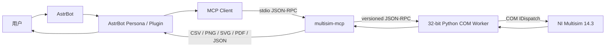
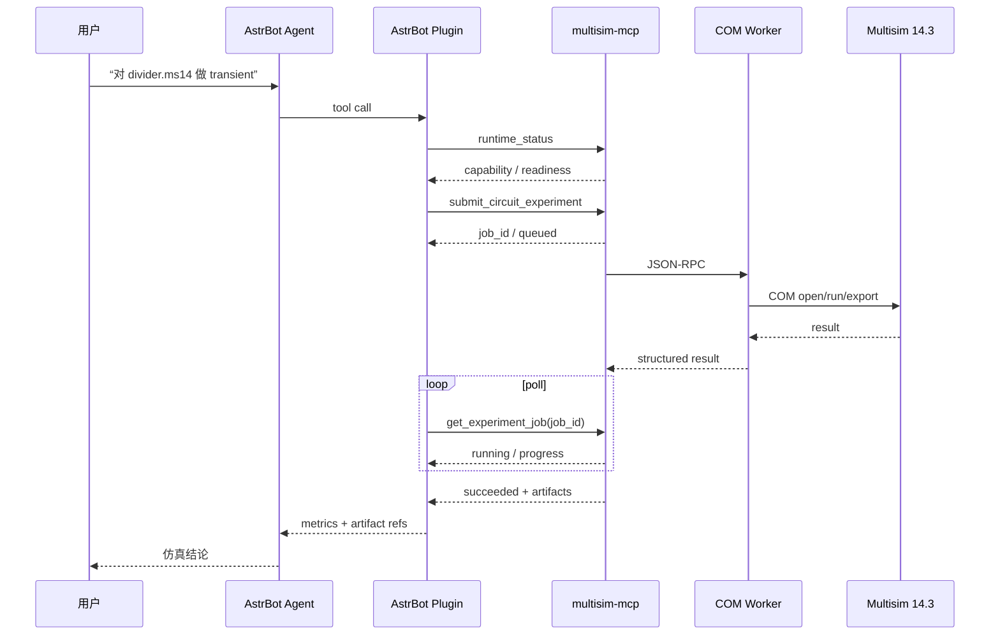

# 面向 AstrBot 的 NI Multisim 14.3 Agent 自动化插件调研报告

## 执行摘要与目标约束

本项目的最短可行路径已经比较清晰：**不建议从零实现 Multisim 自动化层，而应优先复用 `multisim-mcp`，让 AstrBot 通过其原生 MCP 客户端直接接入；AstrBot 插件主要承担权限、任务编排、结果整理和面向用户的工作流，而不是重新封装 NI COM。** AstrBot 当前原生支持 stdio、Streamable HTTP 和 SSE 三类 MCP transport，并能把 MCP 工具直接暴露给 Persona/Agent；`multisim-mcp` 则已经实现本地 MCP Server、Multisim COM 32 位 worker、仿真、可编辑 `.ms14` 生成、数据导出、任务队列、超时和恢复。两者的接口边界天然匹配。citeturn710533search2turn948091search3turn948091search1

截至 **2026 年 10 月 29 日**，`multisim-mcp` 的 PyPI 最新正式版为 **1.3.0，发布于 2026-10-26**，许可证为 MIT，要求 Python ≥3.10；PyPI 还提供了 GitHub Actions 发布来源的 provenance attestation。其仓库记录了真实 **Multisim 14.3** 的回归测试，包括模拟、数字、两板数字电路以及 DC/TRAN/AC 场景，因此它是当前调研到的、与目标最接近且已有 14.3 实机证据的实现。需要注意：仓库 README 部分文字仍描述“1.3.0 准备发布”，而 PyPI 已实际发布 1.3.0；对于版本状态应以 2026-10-26 的 PyPI 记录为准。citeturn919116search0turn948091search1

NI 官方 Automation API 本身是较成熟的 COM 自动化接口，核心对象是 `MultisimApp` 和 `MultisimCircuit`，官方明确支持打开设计、运行仿真、读取结果、修改部分输入和电路参数、执行 SPICE netlist 等操作；但 API 的电路编辑能力有限，并非完整的“原理图绘制 API”。官方还明确指出 `OpenFile` 一次只能维护一个当前电路，因此**单 Multisim 实例应按串行资源管理**。citeturn420606search0turn420606search3turn420606search13

因此建议的开发路线是：

1. **第一优先级：AstrBot → 原生 MCP → `multisim-mcp` stdio → 32-bit COM worker → Multisim 14.3**。
2. 第二阶段再增加一个薄的 AstrBot 插件，用于 `/multisim` 命令、实验模板、用户审批、工作目录隔离、artifact 展示和任务状态管理。
3. 若 AstrBot 与 Multisim 不在同一 Windows 主机，再增加一个**受认证的远程代理层**，不要直接把 `multisim-mcp` 的 stdio 服务暴露到网络。
4. `pywinauto`/AutoHotkey 只作为 COM 和 MCP 无法覆盖的 UI 功能兜底，不应成为主自动化链路。`multisim-mcp` 自身也明确规定其 stdio server 只适合可信本机使用。citeturn948091search6turn968200search4

已知目标与约束如下：目标为开发 **AstrBot 插件**；环境为 **Windows + NI Multisim 14.3**；优先复用 `multisim-mcp` 或同类方案；代码要求清晰、低耦合、高内聚，不做过度防御性测试。语言偏好、部署方式、CI/CD、目标 AstrBot 最低版本、是否使用 Docker、NI 授权类型、远程访问要求和最终开源许可证均为**未指定**。NI 目前提供 Multisim 14.3.0/14.3.1 Education 下载，并要求对应许可激活；具体可使用的 Edition 取决于购买或学校/组织授权。citeturn308259search7turn308259search0

## 生态项目与可复用组件

| 项目/组件 | 状态 | 许可证 | 主要能力 | 14.3 兼容性 | 活跃度/结论 |
|---|---|---|---|---|---|
| [yxy050208/multisim-mcp](https://github.com/yxy050208/multisim-mcp) | **已验证可用** | MIT | MCP、COM worker、`.ms14`、DC/AC/TRAN、SPICE、CSV/SVG/PDF、队列、恢复、扫参 | **仓库有真实 14.3 回归证据** | PyPI 1.3.0 于 2026-10-26 发布，首选。citeturn919116search0turn948091search1 |
| [SaiVatsal/MCP-server-for-Ni-Multisim](https://github.com/SaiVatsal/MCP-server-for-Ni-Multisim) | 部分验证 | 未指定 | 基于 `multisim-mcp` 的安装、诊断和 Agent 使用说明 | README 展示 14.1 COM 实测 | 更适合作为配置案例而非底层依赖。citeturn757147search9 |
| [NI Multisim Automation API](https://www.ni.com/docs/en-US/bundle/multisim/page/topics/overview.html) | **官方、已验证接口** | NI 软件许可 | COM 自动化、文件、仿真、I/O、分析、SPICE | 官方当前文档覆盖 Multisim；具体本机 COM 注册仍需检查 | 稳定底座。citeturn420606search0turn420606search1 |
| [AstrBot MCP](https://docs.astrbot.app/en/use/mcp.html) | **官方、已验证接口** | 随 AstrBot 项目许可 | stdio、Streamable HTTP、SSE、Persona 工具授权 | 与 Multisim 无直接版本耦合 | 可以直接接 `multisim-mcp`。citeturn710533search2 |
| [pywinauto](https://pywinauto.readthedocs.io/) | 通用可用 | 开源 | Win32/UIA GUI 自动化 | **需在 Multisim 14.3 本机验证** | 兜底，不建议主链路。citeturn968200search4turn968200search5 |
| [winax/node-activex](https://github.com/durs/node-activex) | 通用 COM bridge | 见项目仓库 | Node.js `IDispatch`/ActiveX COM 调用 | **需在 Multisim 14.3 本机验证** | 可做 Node 原型，但位数匹配是关键。citeturn968200search0 |

`multisim-mcp` 的价值不只是“给 COM 套一个 MCP 壳”。其 EDA core 文档显示，Multisim COM 和 `.ms14` codec 操作被隔离进**有状态 32 位 worker**，主进程通过版本化 JSON-RPC 与 worker 通信，并使用锁把 COM 操作串行化；worker 崩溃或 RPC 超时可以被重启。核心领域层不依赖 MCP 或 COM，这正符合低耦合、高内聚的设计目标。citeturn948091search3

其 Agent API 还定义了稳定的 `runtime_status.api_contract`、作业状态、结果验收状态以及 artifact contract；对于异步实验可使用 `submit_*` → `get_experiment_job` / Resource 查询，状态包括 queued、running、cancelling、succeeded、failed、cancelled、timed_out。结果若为 `unverified`，项目明确要求不能把“生成了 `.ms14` 文件”错误解释成“电路已验证正确”。citeturn948091search0turn948091search5

一个典型的 MCP 配置可直接映射到 AstrBot 的 stdio MCP 配置：

```json
{
  "command": "C:\\Python32\\python.exe",
  "args": ["-m", "multisim_mcp.server"],
  "env": {
    "MULTISIM_MCP_TEMPLATE_DIR": "C:\\MultisimMcp\\component-pack"
  }
}
```

该部署模式是 `multisim-mcp` 官方仓库明确支持的路径；Multisim COM 放在独立 32 位 worker 后，MCP frontend 可以是 32 位或 64 位 Python。citeturn710533search7turn948091search3

## Multisim 自动化接口与 multisim-mcp 工作原理

NI 官方 Automation API 是第一优先级自动化接口。官方文档说明任何支持 COM 的客户端都可以使用该 API，暴露的核心对象是 `MultisimApp` 与 `MultisimCircuit`。典型生命周期为创建 `MultisimInterface.MultisimApp` → `Connect()` → `OpenFile()` → 配置输出/分析 → 运行 → 读取结果 → `Disconnect()`。官方 C++ 示例也使用 `CreateDispatch(L"MultisimInterface.MultisimApp")`。citeturn420606search0turn236178search7

| 接口 | 调用思路 | 状态 | 稳定性 | 主要限制 |
|---|---|---|---|---|
| COM / Automation API | `MultisimInterface.MultisimApp` | **已验证可用** | 高 | 只打开一个当前 circuit；COM 位数/注册需匹配。citeturn420606search3turn236178search7 |
| Automation `RunSimulation` | `circuit.RunSimulation(seconds, pause)` | 官方 API | 高 | 属于瞬态仿真；不要与正在执行的 AC 分析并发。citeturn468299search0turn468299search8 |
| Output API | `EnumOutputs` → `SetOutputRequest` → `GetOutputData` | **已验证可用** | 高 | 常规 circuit 必须预置 probe，且 request 要在仿真开始前设置。citeturn420606search5turn236178search6 |
| `DoCommandLine` | SPICE/Nutmeg command file | **官方可用** | 中高 | 异步；属于专家接口；任意命令存在安全风险。citeturn468299search9 |
| `.cir` SPICE 导入 | File → Open `.cir` | **官方可用** | 中 | 标准 Berkeley SPICE 较可靠；复杂 subckt/参数不保证支持。citeturn420606search12 |
| Arbitrary SPICE Block | schematic 内嵌 netlist | **官方可用** | 中 | 依赖 Multisim SPICE/XSPICE 方言。citeturn420606search12 |
| MCP Server | `multisim-mcp` MCP tools | **14.3 有实测** | 中高 | 非 NI 官方项目，需要本机授权 Multisim。citeturn948091search1 |
| pywinauto / AutoHotkey | 操作菜单、对话框、窗口 | **需本机验证** | 低~中 | GUI 布局、语言、焦点、DPI、锁屏均可能影响稳定性。pywinauto 官方也专门讨论了远程/锁屏限制。citeturn968200search12 |

一个特别重要的 NI API 限制是：`OpenFile()` 同时只能维持一个当前 circuit，新文件会关闭旧文件，并使旧 `MultisimCircuit` 引用失效。因此在插件架构上，不要把“每个聊天会话”直接映射成独立 COM circuit 对象；正确方式应是**作业队列 + 单 Multisim worker 串行执行**。citeturn420606search3

结果读取也有明确约束。NI 要求电路中存在 probe，`SetOutputRequest()` 必须在开始仿真前调用，仿真后再通过 `GetOutputData()` 获取结果。若只是执行 SPICE command-line 模式，则可以不依赖 schematic probe。citeturn420606search5turn236178search6turn468299search9

`multisim-mcp` 在 Agent 面前使用标准 MCP。MCP 的标准编码是 **UTF-8 JSON-RPC**；stdio transport 中 Client 启动 Server 子进程，JSON-RPC 消息通过 stdin/stdout 交换，日志必须写 stderr 而不能污染 stdout。MCP 还定义了 Streamable HTTP 作为标准远程 transport。citeturn710533search6

但 `multisim-mcp` 内部还有一层与 MCP 不同的 IPC：它把 32 位 COM worker 与前端之间的调用放在**版本化 JSON-RPC 边界**后，并进行串行调用、heartbeat、取消、timeout 与 worker crash restart。当前公开文档没有说明其内部 worker 使用 TCP、Named Pipe 还是标准流作为具体底层承载，因此这一项应标记为**“底层 transport 未指定，不应根据 JSON-RPC 推断为 TCP”**。citeturn948091search3

安全方面，`multisim-mcp` 的默认 MCP 是**本地 stdio、无网络认证语义**；其权限就是启动进程用户拥有的 Windows 文件系统与桌面权限。因此作者明确要求不要直接暴露给不可信网络。默认允许的 command-engine 分析仅为 `op`、`dc`、`ac`、`tran`；任意 command file 需要显式打开 `MULTISIM_MCP_ENABLE_UNSAFE_COMMANDS=1`。citeturn710533search8

常见故障及处理优先级应为：先跑 `multisim-mcp --json doctor --connect` 检查 Python 位数、COM 注册、Live Connection 和 Simulation Engine；再检查 32 位 `pywin32`、Multisim 许可与目标版本；最后才检查 Agent/MCP。已有 14.1 的公开案例展示了该 doctor 流程能够检测到 `MultisimInterface.MultisimApp` 和 COM CLSID。该案例不能替代你的 14.3 本机验证。citeturn757147search9

## AstrBot 集成与推荐架构

AstrBot 已经原生具备 MCP 管理界面和 Agent function calling，因此**最轻量的 MVP 甚至不需要自己实现 MCP client**。管理员可在 `Extensions → MCP Servers` 添加 stdio server，再在 Persona Capabilities 中选择该 MCP server 的工具。AstrBot 官方支持 stdio、Streamable HTTP、SSE，并建议本地进程用 stdio、远程服务优先 Streamable HTTP。citeturn710533search2turn710533search3

如果需要真正的 AstrBot 插件，插件可以通过 `@filter.llm_tool` 或 `context.add_llm_tools()` 注册函数；AstrBot 还提供 `tool_loop_agent()`，支持 `max_steps` 和 `tool_call_timeout`。当前文档提醒 `context.register_llm_tool()` 已弃用，新插件不应使用。citeturn710533search0turn710533search5

### 轻量本地桥接方案



该方案建议作为默认方案，因为 AstrBot 和 `multisim-mcp` 都已有 stdio MCP 支持，而且 stdio 不需要开放监听端口。Multisim worker 本身按串行 COM 资源处理，所以 AstrBot 可以同时接收多个请求，但进入 Multisim 执行层时应统一排队。citeturn710533search2turn948091search3

建议协议与策略：AstrBot ↔ MCP 使用 stdio；不配置 TCP 端口；每个实验分配 opaque `job_id`；同步调用超时建议用于短操作，实际仿真优先调用 durable submit 工具并轮询状态；Multisim 执行并发设为 **1**，而结果读取、文件展示等纯读取操作可以在插件侧并行。`multisim-mcp` 已有 durable queue、取消、timeout、恢复和 output lease，因此不建议 AstrBot 再实现第二套底层调度器。citeturn948091search5turn710533search8

### 远程代理方案


远程方案中**不要直接把现有 `multisim-mcp` stdio 进程暴露到公网**。应该增加 Gateway，把允许调用的 MCP tools 做白名单，并通过 HTTPS、Bearer/OAuth、IP ACL 或反向代理完成认证。AstrBot 原生支持远程 Streamable HTTP MCP 以及可选认证 headers，因此远程部署可以保持 MCP 语义而无需在插件内自造 REST 协议。citeturn710533search2turn710533search8

推荐通信流程如下：



错误 contract 建议保持简单统一：

```json
{
  "ok": false,
  "code": "MULTISIM_NOT_READY",
  "message": "Multisim COM worker is unavailable",
  "retryable": true,
  "job_id": null
}
```

插件只负责把底层错误归类为“环境未就绪 / 输入无效 / 仿真失败 / 超时 / 取消 / 未验证”，不要吞掉 `multisim-mcp` 的原始诊断信息。对于 `unverified` 必须原样传达，不能转换成成功。该原则与 `multisim-mcp` 的 Agent API contract 一致。citeturn948091search0

## MVP、代码原型与验收

| 优先级 | 功能 | 测试用例 | 验收标准 | 粗略工时 |
|---|---|---|---|---:|
| P0 | `runtime_status` / doctor | Multisim 关闭、开启、未激活 | 能区分 ready / not-ready | 2–4h |
| P0 | 打开 `.ms14` | 合法文件/不存在文件 | 成功打开；错误结构化返回 | 3–5h |
| P0 | OP/DC/AC/TRAN | 电阻分压器 | 结果与手工 Multisim 基线一致 | 6–10h |
| P0 | 异步 job | 30–60s transient | job 可查询、超时、取消 | 5–8h |
| P0 | artifact 返回 | CSV/PNG/PDF | AstrBot 可展示或提供路径 | 4–6h |
| P1 | 从 SPICE 生成 editable `.ms14` | divider `.cir` | Multisim 可重新打开编辑 | 6–12h |
| P1 | 参数 sweep | R2 多个值 | 每个 run 有结构化结果 | 5–8h |
| P1 | AstrBot `/multisim` 命令 | status/run/cancel | 指令可触发对应 workflow | 4–8h |
| P2 | GUI fallback | 打开指定菜单 | 关键 UI 操作可自动执行 | 8–16h |
| P2 | 远程 Gateway | 另一主机调用 | TLS+auth，Multisim 不暴露公网 | 12–24h |

这些估算是工程粗估，不是来源中的官方数据；实际差异最大的部分会是 **Multisim 14.3 本机 COM/模板环境搭建**和自定义电路类型验证。`multisim-mcp` 已提供 real-Multisim E2E 入口，并建议设置 `MULTISIM_MCP_E2E_SAMPLE` 后运行其 E2E 测试。citeturn948091search5

### Python COM 核心示例

下面代码依据 NI 官方 COM 对象模型编写，但**本报告环境未连接真实 Multisim 14.3，因此代码本身标记为“需在 Multisim 14.3 本机验证”**。官方已经验证 `MultisimInterface.MultisimApp`、`Connect`、`OpenFile`、`RunSimulation` 等接口存在。citeturn236178search7turn468299search0

```python
# 需在 Multisim 14.3 本机验证
# 推荐：32-bit Python + pywin32
# pip install pywin32

import time
import win32com.client

MS_FILE = r"C:\multisim\fixtures\divider.ms14"

app = win32com.client.Dispatch("MultisimInterface.MultisimApp")

try:
    app.Connect()

    circuit = app.OpenFile(MS_FILE)

    # RunSimulation(numSeconds, pause)
    circuit.RunSimulation(0.1, False)

    # 0/1/2 对应具体枚举值时，建议实际项目从类型库读取，
    # 不要在业务层散布 magic numbers。
    while circuit.SimulationState == 1:
        time.sleep(0.05)

    print("SimulationState:", circuit.SimulationState)
    print("LastError:", circuit.LastErrorMessage)

finally:
    app.Disconnect()
```

正式实现不建议让 AstrBot plugin 直接运行以上 COM 代码，因为这会把 AstrBot 生命周期、Python 位数、COM Apartment、Multisim 生命周期耦合在一起。把它放在独立 worker 或直接复用 `multisim-mcp` 更合理；后者已验证“64 位前端 → 32 位 worker → Multisim 14.3”路径。citeturn948091search3

### Node.js COM 核心示例

`winax` 提供 Node.js 的 COM `IDispatch` bridge，并明确说明 Node bitness 与 COM 组件位数需要匹配。下面同样属于**“需在 Multisim 14.3 本机验证”**，不建议作为 MVP 主实现。citeturn968200search0

```javascript
// Windows only
// npm install winax
// 需在 Multisim 14.3 本机验证

const winax = require("winax");

const app = new winax.Object("MultisimInterface.MultisimApp");

try {
  app.Connect();

  const circuit = app.OpenFile(
    "C:\\multisim\\fixtures\\divider.ms14"
  );

  circuit.RunSimulation(0.1, false);

  console.log("SimulationState =", circuit.SimulationState);
  console.log("LastErrorMessage =", circuit.LastErrorMessage);
} finally {
  app.Disconnect();
}
```

如果 Node 只是为了实现 AstrBot 与 `multisim-mcp` 的通信，则完全没有必要经过 `winax`：直接使用 MCP SDK 做 stdio/Streamable HTTP client 更干净。AstrBot 本身已经实现了这层，所以插件端甚至可以不直接依赖 Node。citeturn710533search2

## 可直接使用的 `agent.md` 草稿

以下内容可以直接保存为开发工作区根目录的 `agent.md`：

```markdown
# agent.md

## Project

本项目开发 AstrBot 插件，使 Agent 能调用 Windows 上的 NI Multisim 14.3
完成电路打开、生成、仿真、测量、扫参和实验报告输出。

首选后端：
AstrBot -> MCP -> multisim-mcp -> 32-bit COM worker -> NI Multisim 14.3

不要在 AstrBot 插件中重新实现已有的 Multisim COM 自动化逻辑，
除非 multisim-mcp 明确不能覆盖目标能力。

## Goals

- 支持 Multisim 14.3。
- 优先使用 multisim-mcp。
- 对 Agent 提供结构化且最小的工具接口。
- 保持低耦合、高内聚。
- 仿真结果必须区分 pass / fail / unverified / error。
- 不得因为成功生成 .ms14 文件就认为电路已经验证。
- 长时间仿真必须使用 job 模式。
- COM / Multisim 操作默认串行。

## Non-goals

- 不重写 SPICE simulator。
- 不实现完整 Multisim GUI clone。
- 不把 Multisim COM 直接暴露到公网。
- 不在第一阶段依赖 GUI automation。
- 不做与实际故障模型无关的过度防御性测试。

## Environment

Target OS:
- Windows

Target simulator:
- NI Multisim 14.3

Preferred backend:
- multisim-mcp

Unspecified:
- Multisim edition / license type
- CI/CD
- deployment model
- final plugin license
- remote access requirements
- minimum AstrBot version

## Architecture

Suggested modules:

astrbot_plugin_multisim/
├── __init__.py
├── main.py
├── config.py
├── domain/
│   ├── models.py
│   └── errors.py
├── application/
│   ├── simulation_service.py
│   └── job_service.py
├── infrastructure/
│   ├── mcp_backend.py
│   ├── artifact_store.py
│   └── healthcheck.py
├── presentation/
│   ├── commands.py
│   └── llm_tools.py
├── tests/
│   ├── unit/
│   └── integration/
├── requirements.txt
└── README.md

Dependency direction:

presentation
    -> application
        -> domain

infrastructure
    -> application interfaces

domain must not import AstrBot, MCP, COM, pywin32 or GUI libraries.

## Backend interface

Define a narrow backend protocol.

Example:

class MultisimBackend(Protocol):
    async def status(self) -> RuntimeStatus: ...
    async def submit_experiment(self, request: ExperimentRequest) -> JobHandle: ...
    async def get_job(self, job_id: str) -> JobStatus: ...
    async def cancel_job(self, job_id: str) -> None: ...

Do not expose raw COM objects outside infrastructure/.

## Tool design

Agent-facing tools should be small and explicit.

Preferred tools:

- multisim_status
- multisim_run_experiment
- multisim_get_job
- multisim_cancel_job
- multisim_list_artifacts

Do not expose arbitrary shell execution.
Do not expose unrestricted filesystem paths.
Do not expose unsafe Multisim command files by default.

## Input contract

Every experiment request should contain:

- source
- analysis type
- analysis parameters
- requested measurements
- output directory identifier
- overwrite flag

Paths supplied by an LLM must be normalized and restricted to configured roots.

## Output contract

Return JSON-compatible structured values.

Success:

{
  "ok": true,
  "job_id": "...",
  "state": "succeeded",
  "verification": "pass|fail|unverified",
  "measurements": {},
  "artifacts": []
}

Failure:

{
  "ok": false,
  "code": "...",
  "message": "...",
  "retryable": false,
  "job_id": "..."
}

Never turn `unverified` into success.

## Concurrency

Treat one Multisim application/COM worker as a single serialized execution resource.

Do not run two Multisim simulations against the same worker concurrently.

Parallelism is allowed for:
- parsing
- LLM work
- reading completed artifacts
- report formatting

## Timeouts

Use short timeout for:
- status
- metadata
- tool discovery

Use durable job submission for:
- transient simulations
- sweeps
- schematic generation
- optimization

Do not keep one AstrBot LLM tool call blocked for a long simulation if a job API exists.

## Error handling

Expected error classes:

- BackendUnavailable
- MultisimNotReady
- InvalidExperiment
- SimulationFailed
- JobTimedOut
- JobCancelled
- ArtifactUnavailable
- PermissionDenied

Log original backend errors.
Return a short safe message to the model.

Do not hide diagnostic IDs.

## Logging

Use structured logging.

Minimum fields:
- request_id
- conversation_id
- job_id
- tool_name
- backend
- duration_ms
- state

Never log:
- license keys
- access tokens
- proprietary raw circuit contents unless debug mode is explicitly enabled.

## Testing

Unit tests:
- domain models
- error mapping
- result normalization
- path policy
- tool input/output mapping

Integration tests:
- fake MCP backend
- real multisim-mcp without COM where possible

E2E tests:
- Windows + licensed Multisim 14.3
- small deterministic fixtures only

Required fixtures:
- resistor divider
- RC transient circuit
- simple AC filter

Do not mock every internal method.
Mock system boundaries.

Do not test Python/library implementation details.

## Coding style

Python:
- type hints required on public interfaces
- async for AstrBot I/O
- dataclasses or Pydantic for contracts
- Ruff for formatting/linting
- small modules
- dependency injection for backends

Avoid:
- global mutable COM state
- giant plugin classes
- duplicated retry logic
- catch-all `except Exception: pass`
- magic numbers for Multisim enum values

## Security

Default trust model:
- trusted local Windows host
- stdio MCP

Do not expose multisim-mcp directly to an untrusted network.

Remote deployment must add:
- TLS
- authentication
- allowlisted tools
- restricted output roots
- audit logging

Unsafe command execution remains disabled by default.

## Development rule

Before adding new Multisim automation code:

1. Check whether multisim-mcp already provides the capability.
2. Check NI Automation API documentation.
3. Add GUI automation only if both are insufficient.
4. Mark any untested Multisim 14.3 behavior as:
   "需在 Multisim 14.3 本机验证".

## Definition of Done

A feature is complete when:

- interface contract is documented
- unit test covers business mapping
- integration test covers backend boundary
- Multisim-dependent behavior is either:
  - verified on Multisim 14.3, or
  - clearly marked as not yet verified
- failure is observable in logs
- no new unnecessary coupling was introduced
```

该草稿的 AstrBot 部分与其官方插件指南相符：插件依赖写入 `requirements.txt`、持久化数据放在 data 目录、网络调用应使用异步库而不是 `requests`、提交前建议 Ruff；function tools 应使用当前的 `add_llm_tools()` 或 decorator 接口。citeturn757147search10turn710533search0

## 面向模型的开发路线、风险与资料优先级

### 路线指导

**阶段 A：只打通现成 MCP，不写 COM。** 在目标 Windows 主机安装并激活 Multisim 14.3，再准备一套可工作的 32 位 Python/pywin32 环境，安装 `multisim-mcp==1.3.0`。首先运行 doctor，而不是直接写 AstrBot 插件。PyPI 1.3.0 是截至 2026-10-29 的当前正式版。citeturn919116search0turn757147search9

```powershell
C:\Python32\python.exe -m pip install multisim-mcp==1.3.0

C:\Python32\Scripts\multisim-mcp.exe --json doctor --connect
```

验收输出应至少证明：Python/worker 环境有效、Multisim COM 可连接、simulation engine ready。具体字段以 1.3.0 的 doctor JSON 为准，不要在插件代码里依赖人类可读字符串。`multisim-mcp` 已定义稳定 JSON CLI contract。citeturn710533search9

**阶段 B：让 AstrBot 直接使用 MCP。** 在 AstrBot WebUI → Extensions → MCP Servers 中添加 stdio server，并把 executable 路径和 args 拆开填写；AstrBot 当前不支持把整段 shell 命令塞进 `command`。连接成功后在 Persona Capabilities 中只开启需要的 Multisim tools。citeturn710533search3

建议第一轮 Agent 测试：

```text
检查 Multisim 是否就绪。

打开测试电阻分压器并执行 DC operating point。

运行一次 transient，并返回 V(out) 的主要测量结果。

列出生成的 CSV、原理图和实验报告。
```

**阶段 C：创建真正的 AstrBot 插件。** 使用官方插件模板，插件名称建议 `astrbot_plugin_multisim`。插件不要复制 MCP schema，而是增加工作流能力，例如 `/ms status`、`/ms run`、审批步骤、实验模板、artifact 展示和用户工作目录绑定。AstrBot 新插件可用 decorator 定义 LLM tool，也可构建 `FunctionTool` 并通过 `add_llm_tools()` 注册。citeturn757147search10turn710533search0

建议先实现：

```python
@filter.llm_tool(name="multisim_status")
async def multisim_status(self, event: AstrMessageEvent):
    """检查 Multisim 自动化环境状态.

    Args:
    """
    ...
```

然后才实现 experiment/job tools。对于超过几十秒或具有不确定耗时的仿真，优先返回 job id，而不是一直占住一个 LLM tool call；AstrBot 自身的 agent loop 支持 `tool_call_timeout`，但它不应替代后端 durable job。citeturn710533search0turn948091search5

**阶段 D：建立真实 14.3 E2E 门禁。** 至少建立 divider、RC transient、RC low-pass AC 三个 fixture。每个测试保存输入、期望量、Multisim 输出及 artifact hash。不要把 `.ms14` 的“成功生成”当作通过条件，而要至少检查仿真结果和明确的 measurement acceptance。citeturn948091search0

建议命令：

```powershell
$env:MULTISIM_MCP_E2E_SAMPLE='C:\fixtures\divider.ms14'

C:\Python32\python.exe `
  mcp_server\tests\e2e_mcp_test.py
```

`multisim-mcp` 官方仓库已提供类似 real Multisim E2E 入口，因此优先复用，不应在插件侧重复搭建底层 COM 测试框架。citeturn948091search5

**阶段 E：最后才补 GUI automation。** 只有 COM/MCP 没有覆盖的对话框、特定仪器 UI 或导出功能才使用 pywinauto/AutoHotkey。pywinauto 支持 Win32 与 Microsoft UI Automation backend，但远程桌面、锁屏和窗口可访问性会改变自动化行为，因此 GUI 测试必须在目标 Windows 桌面环境执行。citeturn968200search5turn968200search12

### 关键风险

| 风险 | 影响 | 缓解 |
|---|---|---|
| NI 授权 | 无有效许可无法稳定运行目标产品 | 使用合法 Multisim license；确认具体 Edition。NI 软件受 NI 软件许可协议约束。citeturn308259search1turn308259search0 |
| 32/64 位 COM | COM activation 失败 | 优先采用 `multisim-mcp` 独立 32-bit worker。citeturn948091search3 |
| 单 circuit 限制 | 并发任务互相关闭文件 | 后端仿真并发=1，用 job queue。citeturn420606search3 |
| GUI 脆弱 | DPI/窗口焦点/锁屏导致失败 | GUI automation 仅兜底。citeturn968200search12 |
| SPICE 方言 | 第三方 netlist 不能完全导入 | 先做 compatibility audit；复杂 subckt 明确标记未验证。NI 官方也说明 `.cir` import 对复杂内容有限制。citeturn420606search12 |
| MCP 网络暴露 | Agent 获得桌面和文件权限 | 默认 stdio；远程只经认证 Gateway。citeturn710533search8 |
| 任意 SPICE/Nutmeg 命令 | 文件和执行面扩大 | 保持 unsafe commands 默认关闭。citeturn710533search8 |
| 第三方模板/NI 资产许可 | 不能随插件重新分发 | 让用户从自己的授权安装生成 local component pack；不要打包 NI 样本/模板。citeturn919116search1 |
| 版本漂移 | MCP schema/工具集合变化 | 启动时读取 `runtime_status.api_contract`，不要硬编码全部工具清单。citeturn948091search0 |
| “生成成功≠工程正确” | Agent 给出错误结论 | 强制使用 measurement/requirement verification，保留 `unverified`。citeturn948091search0 |

### 推荐来源优先级

第一优先级是 **NI 官方 Multisim Automation API**：[Automation API Overview](https://www.ni.com/docs/en-US/bundle/multisim/page/topics/overview.html)、[API Reference](https://www.ni.com/docs/en-US/bundle/multisim/page/topics/api-reference.html)、[OpenFile](https://www.ni.com/docs/en-US/bundle/multisim/page/topics/openfile.html)、[DoCommandLine](https://www.ni.com/docs/en-US/bundle/multisim/page/topics/docommandline.html) 和 [SPICE netlist import](https://knowledge.ni.com/KnowledgeArticleDetails?id=kA03q000000YG0ACAW&l=en-US)。这些来源直接定义 COM 能力与边界，应优先于博客或论坛。citeturn420606search0turn420606search1turn420606search3turn468299search9turn420606search12

第二优先级是 [`multisim-mcp`](https://github.com/yxy050208/multisim-mcp) 仓库及 [PyPI](https://pypi.org/project/multisim-mcp/)；尤其应阅读 `README.md`、`SECURITY.md`、`docs/AGENT_API.md`、`docs/EDA_CORE.md` 和 `mcp_server/README.md`。这些资料目前最直接描述了 **Multisim 14.3 + Agent + MCP** 的真实实现与测试边界。citeturn919116search0turn948091search0turn948091search3turn948091search6

第三优先级是 [AstrBot MCP 官方文档](https://docs.astrbot.app/en/use/mcp.html) 和 AstrBot 官方插件开发资料；因为 AstrBot 已原生实现 MCP client 和 function tool 系统，插件层应遵守这些接口而不是自己创建另一套 Agent protocol。citeturn710533search2turn710533search0

第四优先级才是 NI Community、Stack Overflow、中文博客及 GUI 自动化文章。它们适合定位特定 COM 错误或补足实例，但涉及 API 行为时应回到 NI 官方文档交叉验证。例如 NI Community 中可找到 C++ `CreateDispatch` 和 MATLAB API 实战，但这些案例主要来自旧版 Multisim，因此对 14.3 应视为参考而非兼容性证明。citeturn236178search7turn468299search8

综合来看，当前最合适的工程决策是：**把 `multisim-mcp 1.3.0` 当作 Multisim Adapter，把 AstrBot 当作 MCP Host/Agent Runtime，你的插件只实现 Multisim 领域工作流。** 这样 COM 位数、`.ms14` 编解码、SPICE 安全、仿真队列、worker crash recovery 和 artifact 生成都留在已有项目中，而插件仅维护用户体验、权限和业务编排；这是现有证据下实现成本最低、耦合最小、也最容易逐步验证 Multisim 14.3 兼容性的路线。citeturn919116search0turn948091search3turn710533search2